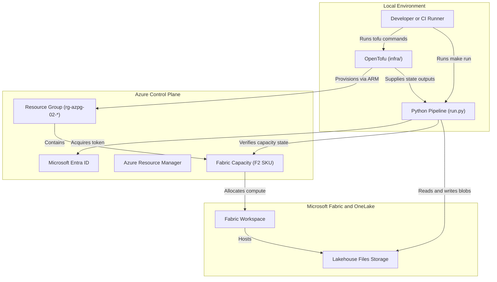

### 02: Medallion Lakehouse on Microsoft Fabric

Create sandbox Microsoft Fabric capacity with OpenTofu, execute a Bronze-Silver-Gold medallion
pipeline in OneLake using Python, verify aggregated business metrics, and remove temporary artifacts.

#### Architecture



#### Medallion Pipeline Flow

The Python runner executes a multi-stage medallion pipeline across OneLake storage tiers:

```mermaid
flowchart LR
    subgraph Ingestion["Ingestion"]
        RawEvents["Raw Event Payloads"]
    end

    subgraph Bronze["Bronze Stage"]
        BronzeBlob["Raw JSONL Storage: Files/bronze/{batch_id}"]
    end

    subgraph Silver["Silver Stage"]
        Cleaner["Validation and Deduplication"]
        SilverBlob["Cleaned Records: Files/silver/{batch_id}"]
    end

    subgraph Gold["Gold Stage"]
        Aggregator["Business Metric Aggregations"]
        GoldBlob["Summary Metrics: Files/gold/{batch_id}"]
    end

    subgraph Verification["Verification and Teardown"]
        Reconcile["Metric Reconciliation"]
        Cleanup["Temporary Batch Artifact Teardown"]
    end

    RawEvents -->|" Upload "| BronzeBlob
    BronzeBlob -->|" Read and validate "| Cleaner
    Cleaner -->|" Write structured records "| SilverBlob
    SilverBlob -->|" Read and aggregate "| Aggregator
    Aggregator -->|" Write aggregated metrics "| GoldBlob
    GoldBlob -->|" Download and verify "| Reconcile
    Reconcile -->|" Remove batch files "| Cleanup
```



#### Prerequisites

- Python 3.14 or newer, uv, GNU Make, Azure CLI, and OpenTofu 1.8 or newer.
- A non-production public Azure subscription with available credits.
- Permission to create resource groups and Fabric capacities (`Microsoft.Fabric/capacities`).
- The `Microsoft.Fabric` provider registered in your subscription:

```bash
az provider show --subscription YOUR_SUBSCRIPTION_ID \
  --namespace Microsoft.Fabric --query registrationState --output tsv
```

If the state is not `Registered`, register it with:

```bash
az provider register --subscription YOUR_SUBSCRIPTION_ID --namespace Microsoft.Fabric
```

#### Cost and Credit Management

Fabric capacity incurs compute charges while active:

- The configuration specifies an `F2` capacity (the lowest pay-as-you-go SKU, approximately $0.36 per hour).
- Run `make suspend` immediately after testing to pause compute billing. Suspended capacities retain their definitions and workspace links without
  active compute charges.
- Run `make resume` when you are ready to execute another pipeline run.
- Run `make down` to remove all cloud resources and destroy the capacity completely.

#### Configure the Sandbox

```bash
cd projects/02-fabric-lakehouse
cp infra/terraform.tfvars.example infra/terraform.tfvars
az account list --query '[].{name:name,id:id}' --output table
az ad signed-in-user show --query id --output tsv
```

Update each variable in `infra/terraform.tfvars`:

- `subscription_id` is your sandbox subscription UUID.
- `location` is an allowed Fabric region, such as `westeurope` or `eastus`.
- `resource_group_name` is a dedicated resource group starting with `rg-azpg-02-`.
- `fabric_capacity_name` is a globally unique name starting with `azpg02`.
- `principal_object_id` is the signed-in user object ID returned by the Azure CLI command above.

#### Deploy Infrastructure

Preview and create the sandbox resources:

```bash
make plan
make up
```

Type `yes` when prompted to approve the saved plan.

#### Run the Medallion Pipeline

Run the end-to-end pipeline using the root Python virtual environment:

```bash
make run
```

The script performs the following actions:

1. Validates the verified capacity scope and checks that the capacity is active.
2. Ingests raw batch transaction events to the Bronze layer in OneLake.
3. Cleans, validates timestamps, deduplicates keys, and saves structured records to the Silver layer.
4. Aggregates financial and volume metrics into summary metrics in the Gold layer.
5. Reconciles Gold metrics against expected counts and totals.
6. Deletes batch artifacts and leaves the workspace clean.

#### Suspend or Clean Up

To pause capacity charges while preserving your configuration:

```bash
make suspend
```

To resume the paused capacity later:

```bash
make resume
```

To remove all resources completely when finished:

```bash
make down
```

Type `yes` to confirm destruction.
