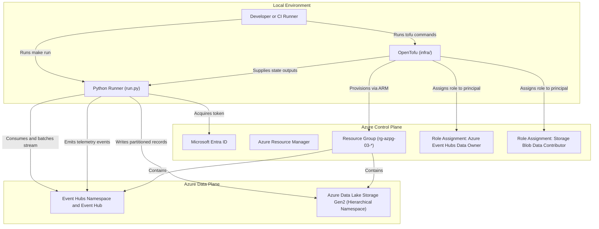
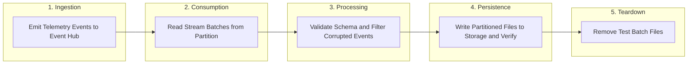

### 03: Event Streaming Ingestion with Event Hubs and Functions

Ingest real-time telemetry into Azure Event Hubs, process and validate streaming records with Python, and persist partitioned data into Azure Data Lake Storage Gen2.

#### Architecture



#### Streaming Pipeline Flow

The pipeline executes a self-contained streaming ingest, validation, persistence, and cleanup cycle:



#### Prerequisites

- Python 3.14 or newer, uv, GNU Make, Azure CLI, and OpenTofu 1.8 or newer.
- A non-production Azure subscription, an allowed region, and network access to Azure management, identity, Event Hubs, and storage endpoints.
- Role management permissions on the resource group to assign `Azure Event Hubs Data Owner` and `Storage Blob Data Contributor`.
- The `Microsoft.EventHub` and `Microsoft.Storage` resource providers registered on your subscription.

From the repository root, install dependencies and sign in:

```bash
make install
make login
```

#### Configure the Sandbox

Navigate to the project directory and prepare configuration:

```bash
cd projects/03-event-streaming
cp infra/terraform.tfvars.example infra/terraform.tfvars
az account list --query '[].{name:name,id:id}' --output table
az ad signed-in-user show --query id --output tsv
```

Update each field in `infra/terraform.tfvars`:

- `subscription_id`: The target Azure subscription identifier.
- `location`: An allowed Azure region, such as `norwayeast` or `northeurope`.
- `resource_group_name`: A dedicated name starting with `rg-azpg-03-`.
- `storage_account_name`: A globally unique name starting with `azpg03`, containing only lowercase alphanumeric characters.
- `eventhub_namespace_name`: A globally unique name starting with `azpg03`, containing only lowercase alphanumeric characters and hyphens.
- `principal_object_id`: The object identifier of your signed-in identity.

Verify resource provider registrations:

```bash
az provider show --subscription YOUR_SUBSCRIPTION_ID \
  --namespace Microsoft.EventHub --query registrationState --output tsv
az provider show --subscription YOUR_SUBSCRIPTION_ID \
  --namespace Microsoft.Storage --query registrationState --output tsv
```

Both commands must return `Registered`.

#### Run and Clean Up

```bash
make plan
make up
make run
make down
```

- `make plan` displays an execution plan for the Event Hubs namespace, Event Hub, storage account with hierarchical namespace enabled, and role assignments.
- `make up` requires entering `yes` before provisioning infrastructure.
- `make run` prompts for confirmation, emits synthetic IoT sensor telemetry to the Event Hub, consumes the stream, processes valid records, writes partitioned outputs to storage, and reconciles counts.
- `make down` requires entering `yes` and destroys all sandbox resources created for this project.

#### Common Issues and Troubleshooting

- Missing provider registration: If OpenTofu returns `MissingSubscriptionRegistration`, run `az provider register --namespace Microsoft.EventHub` and wait until the status changes to `Registered`.
- Event Hub authorization failure: If `run.py` encounters `401 Unauthorized` or authentication errors when sending or receiving events, verify that the signed-in CLI identity matches `principal_object_id` and that the `Azure Event Hubs Data Owner` role assignment has propagated.
- Storage data plane access error: Ensure your identity has `Storage Blob Data Contributor` on the storage account.
