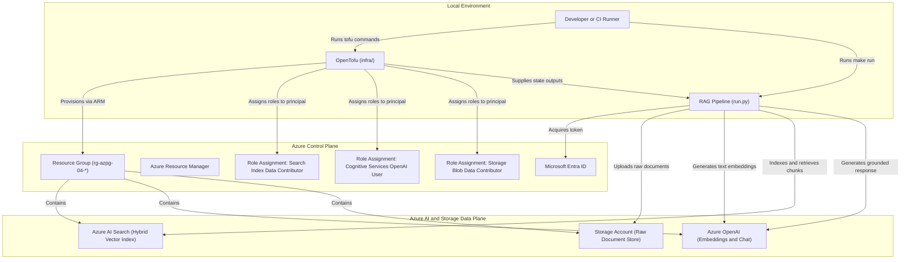

### 04: Retrieval-augmented Generation with Azure AI Search and Azure OpenAI

Ingest Markdown documentation, generate vector embeddings using Azure OpenAI, create a hybrid vector and keyword index in Azure AI Search, and generate grounded answers with source citations using Python.

#### Architecture



#### Retrieval-augmented Generation Lifecycle Flow

The Python runner executes a complete, self-contained RAG indexing, query, evaluation, and cleanup cycle:

```mermaid
flowchart LR
    subgraph Step1["1. Chunking"]
        ChunkDocs["Parse and Chunk Documents"]
    end

    subgraph Step2["2. Vectorization"]
        EmbedChunks["Generate Embeddings via OpenAI"]
    end

    subgraph Step3["3. Indexing"]
        UploadIndex["Upload Vectors and Text to AI Search"]
    end

    subgraph Step4["4. Retrieval"]
        HybridSearch["Perform Hybrid Search with Re-ranking"]
    end

    subgraph Step5["5. Synthesis"]
        GenerateAnswer["Generate Grounded Answer with Citations"]
    end

    subgraph Step6["6. Teardown"]
        CleanArtifacts["Delete Test Index and Storage Blobs"]
    end

    ChunkDocs --> EmbedChunks
    EmbedChunks --> UploadIndex
    UploadIndex --> HybridSearch
    HybridSearch --> GenerateAnswer
    GenerateAnswer --> CleanArtifacts
```



#### Prerequisites

- Python 3.14 or newer, uv, GNU Make, Azure CLI, and OpenTofu 1.8 or newer.
- A non-production Azure subscription with access to Azure OpenAI Service and Azure AI Search.
- Allowed deployment region supporting both Azure OpenAI and Azure AI Search (such as `norwayeast`, `swedencentral`, or `westeurope`).
- Role assignment permissions on the resource group to assign `Search Index Data Contributor`, `Cognitive Services OpenAI User`, and `Storage Blob Data Contributor`.
- The `Microsoft.Search`, `Microsoft.CognitiveServices`, and `Microsoft.Storage` resource providers registered on your subscription.

From the repository root, install dependencies and sign in:

```bash
make install
make login
```

#### Configure the Sandbox

Navigate to the project directory and prepare configuration:

```bash
cd projects/04-rag-ai-search
cp infra/terraform.tfvars.example infra/terraform.tfvars
az account list --query '[].{name:name,id:id}' --output table
az ad signed-in-user show --query id --output tsv
```

Update each field in `infra/terraform.tfvars`:

- `subscription_id`: The target Azure subscription identifier.
- `location`: An Azure region where both Azure OpenAI and Azure AI Search are supported, such as `norwayeast` or `swedencentral`.
- `resource_group_name`: A dedicated name starting with `rg-azpg-04-`.
- `storage_account_name`: A globally unique name starting with `azpg04`, containing only lowercase alphanumeric characters.
- `search_service_name`: A globally unique name starting with `azpg04`, containing only lowercase alphanumeric characters and hyphens.
- `search_service_sku`: The pricing tier for Azure AI Search (`basic` or `free`). Note that Azure permits only one `free` tier search service per subscription.
- `openai_account_name`: A globally unique Cognitive Services account name starting with `azpg04`.
- `principal_object_id`: The object identifier of your signed-in identity.

Verify resource provider registrations:

```bash
az provider show --subscription YOUR_SUBSCRIPTION_ID \
  --namespace Microsoft.Search --query registrationState --output tsv
az provider show --subscription YOUR_SUBSCRIPTION_ID \
  --namespace Microsoft.CognitiveServices --query registrationState --output tsv
az provider show --subscription YOUR_SUBSCRIPTION_ID \
  --namespace Microsoft.Storage --query registrationState --output tsv
```

All commands must return `Registered`.

#### Run and Clean Up

```bash
make plan
make up
make run
make down
```

- `make plan` displays an execution plan for the storage account, Azure AI Search service, Azure OpenAI account, model deployments (`text-embedding-3-small` and `gpt-4o-mini`), and role assignments.
- `make up` requires entering `yes` before provisioning infrastructure.
- `make run` prompts for confirmation, uploads sample documentation to storage, computes chunk embeddings, creates a hybrid vector index in Azure AI Search, runs a grounded retrieval query, and validates citations.
- `make down` requires entering `yes` and destroys all sandbox resources created for this project.

#### Common Issues and Troubleshooting

- Missing provider registration: If OpenTofu returns `MissingSubscriptionRegistration`, run `az provider register --namespace Microsoft.Search` and wait until the status changes to `Registered`.
- OpenAI access approval: If Azure rejects cognitive account creation, ensure your subscription has been granted access to Azure OpenAI models.
- Single free search service limit: Azure limits each subscription to one `free` tier search service. If you already have one, set `search_service_sku = "basic"` in `infra/terraform.tfvars`.
- Role propagation delay: Azure RBAC role assignments can take several minutes to propagate. If `run.py` fails with authorization errors immediately after `make up`, wait three to five minutes and retry `make run`.
