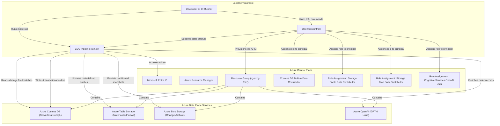
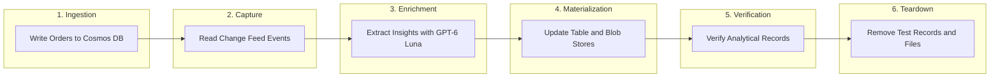

### 05: Change Data Capture with Cosmos DB and Storage

Capture transactional mutations from Azure Cosmos DB, enrich change events using Azure OpenAI GPT-6 Luna, and synchronize materialized analytical
views into Azure Table Storage and Azure Blob Storage.

#### Architecture



#### Change Data Capture Lifecycle Flow

The Python runner executes a self-contained transaction ingestion, change feed consumption, AI enrichment, materialized view synchronization, and
teardown cycle:



#### Prerequisites

- Python 3.14 or newer, uv, GNU Make, Azure CLI, and OpenTofu 1.8 or newer.
- A non-production Azure subscription with access to Azure Cosmos DB and Azure OpenAI Service.
- An allowed deployment region supporting both Azure Cosmos DB and Azure OpenAI (such as `norwayeast` or `swedencentral`).
- Role assignment permissions on the resource group to assign `Storage Table Data Contributor`, `Storage Blob Data Contributor`,
  `Cognitive Services OpenAI User`, and Cosmos DB SQL data contributor roles.
- The `Microsoft.DocumentDB`, `Microsoft.Storage`, and `Microsoft.CognitiveServices` resource providers registered on your subscription.

From the repository root, install dependencies and sign in:

```bash
make install
make login
```

#### Configure the Sandbox

Navigate to the project directory and prepare configuration:

```bash
cd projects/05-change-data-capture
cp infra/terraform.tfvars.example infra/terraform.tfvars
az account list --query '[].{name:name,id:id}' --output table
az ad signed-in-user show --query id --output tsv
```

Update each field in `infra/terraform.tfvars`:

- `subscription_id`: The explicit UUID of your non-production Azure subscription.
- `location`: An Azure region supporting Cosmos DB and Azure OpenAI, such as `norwayeast`.
- `resource_group_name`: A dedicated resource group name beginning with `rg-azpg-05-`.
- `cosmos_account_name`: A globally unique Cosmos DB account name beginning with `azpg05`.
- `storage_account_name`: A globally unique storage account name with 3 to 24 lowercase letters and digits beginning with `azpg05`.
- `openai_account_name`: A globally unique Azure OpenAI account name beginning with `azpg05`.
- `principal_object_id`: The Entra user object ID from `az ad signed-in-user show`.

#### Provision the Resources

1. Preview the planned resources:

   ```bash
   make plan
   ```

2. Review and apply the configuration:

   ```bash
   make up
   ```

   Type `yes` when prompted to approve resource creation.

#### Run the CDC Pipeline

Execute the end-to-end Change Data Capture and AI enrichment runner:

```bash
make run
```

The script:

1. Validates OpenTofu outputs and confirms the target resource group.
2. Writes sample retail orders to Cosmos DB container `orders`.
3. Reads incremental mutations from the Cosmos DB change feed.
4. Invokes Azure OpenAI GPT-6 Luna to determine sentiment, urgency, and category.
5. Upserts materialized entities in Table Storage and writes partitioned archives in Blob Storage.
6. Verifies data consistency across analytical stores.
7. Deletes test Cosmos DB items, Table entities, and temporary Blob files.

#### Teardown

To remove all cloud infrastructure provisioned for this experiment:

```bash
make down
```

Type `yes` when prompted to confirm resource deletion.

#### Cost Management

- Cosmos DB Serverless capacity: Cosmos DB is configured with the `EnableServerless` capability, eliminating fixed hourly throughput charges and
  billing only for consumed Request Units (RUs).
- Shared storage account: Table Storage and Blob Storage reside in a single standard LRS storage account, avoiding multi-account baseline costs.
- Lightweight language model: GPT-6 Luna provides low token latency and minimal expenditure per enrichment call.
- Prompt cleanup: Run `make down` immediately upon completing experiments to destroy all provisioned infrastructure.
