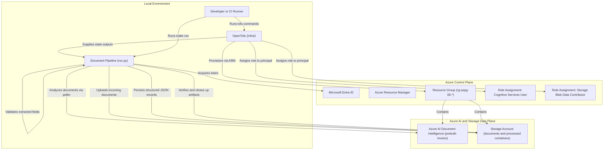

### 06: Multimodal Document Processing with Azure AI Document Intelligence

Ingest sample invoice documents into Azure Blob Storage, extract structured fields and line items with Azure AI Document Intelligence, validate models with Pydantic, and persist structured JSON records.

#### Architecture



#### Document Processing Lifecycle Flow

The Python runner executes a complete, self-contained document analysis, validation, persistence, and cleanup cycle:

```mermaid
flowchart LR
    subgraph Step1["1. Upload"]
        UploadDocs["Upload Invoices to Incoming Folder"]
    end

    subgraph Step2["2. Extraction"]
        ExtractFields["Analyze Documents with Prebuilt Model"]
    end

    subgraph Step3["3. Validation"]
        ValidateSchema["Parse and Validate with Pydantic"]
    end

    subgraph Step4["4. Persistence"]
        PersistJSON["Write Validated JSON to Lakehouse"]
    end

    subgraph Step5["5. Verification"]
        VerifyRecords["Verify Record Content and Schema"]
    end

    subgraph Step6["6. Teardown"]
        CleanArtifacts["Delete Test Blobs and Batch Folders"]
    end

    UploadDocs --> ExtractFields
    ExtractFields --> ValidateSchema
    ValidateSchema --> PersistJSON
    PersistJSON --> VerifyRecords
    VerifyRecords --> CleanArtifacts
```



#### Prerequisites

- Python 3.14 or newer, uv, GNU Make, Azure CLI, and OpenTofu 1.8 or newer.
- A non-production Azure subscription with access to Azure AI Document Intelligence.
- An allowed deployment region supporting Azure AI Services (such as `swedencentral`, `norwayeast`, or `westeurope`).
- Role assignment permissions on the resource group to assign `Cognitive Services User` and `Storage Blob Data Contributor`.
- The `Microsoft.CognitiveServices` and `Microsoft.Storage` resource providers registered on your subscription.

From the repository root, install dependencies and sign in:

```bash
make install
make login
```

#### Configure the Sandbox

Navigate to the project directory and prepare configuration:

```bash
cd projects/06-document-processing
cp infra/terraform.tfvars.example infra/terraform.tfvars
az account list --query '[].{name:name,id:id}' --output table
az ad signed-in-user show --query id --output tsv
```

Update each field in `infra/terraform.tfvars`:

- `subscription_id`: The target Azure subscription identifier.
- `location`: An Azure region where Azure AI Document Intelligence is available, such as `swedencentral` or `norwayeast`.
- `resource_group_name`: A dedicated name starting with `rg-azpg-06-`.
- `storage_account_name`: A globally unique name starting with `azpg06`, containing only lowercase alphanumeric characters.
- `document_intelligence_name`: A globally unique Cognitive Services account name starting with `azpg06`.
- `principal_object_id`: The object identifier of your signed-in identity.

Verify resource provider registrations:

```bash
az provider show --subscription YOUR_SUBSCRIPTION_ID \
  --namespace Microsoft.CognitiveServices --query registrationState --output tsv
az provider show --subscription YOUR_SUBSCRIPTION_ID \
  --namespace Microsoft.Storage --query registrationState --output tsv
```

Both commands must return `Registered`.

#### Run and Clean Up

```bash
make plan
make up
make run
make down
```

- `make plan` displays an execution plan for the storage account, blob containers, Azure AI Document Intelligence account, and role assignments.
- `make up` requires entering `yes` before provisioning infrastructure.
- `make run` prompts for confirmation, uploads sample invoices to storage, extracts key-value pairs and tables using `prebuilt-invoice`, validates models with Pydantic, writes structured JSON records, verifies them, and removes temporary test artifacts.
- `make down` requires entering `yes` and destroys all sandbox resources created for this project.

The runner generates a unique batch identifier for each run.
Console logs report validation progress without invoice identifiers, vendor names, amounts, or raw validation errors.
Raw documents and extracted fields are still sent to Azure and stored temporarily in private blob containers.
Upload failures or analysis errors stop the run immediately.
Cleanup covers uploaded sample files and generated JSON records.
Failed deletions produce a failed exit and identify remaining artifacts. Always run `make down` when finished.

#### Common Issues and Troubleshooting

- Missing provider registration: If OpenTofu returns `MissingSubscriptionRegistration`, run `az provider register --namespace Microsoft.CognitiveServices` and wait until the status changes to `Registered`.
- Role propagation delay: Azure RBAC role assignments can take several minutes to propagate. If `run.py` fails with authorization errors immediately after `make up`, wait three to five minutes and retry `make run`.
- Confidence threshold failure: If an extracted document falls below the minimum required confidence threshold (default 0.70), `run.py` rejects the document and stops the pipeline to maintain data quality.
- Clean resource group deletion: The OpenTofu configuration sets `prevent_deletion_if_contains_resources = false` so that running `make down` cleans up the resource group cleanly even when background operations were interrupted.
