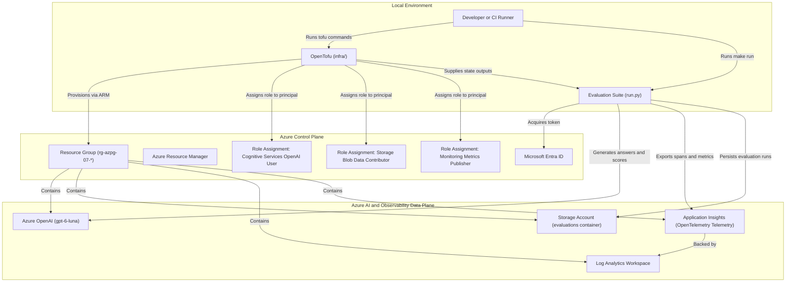

### 07: Generative AI Evaluation and Observability Suite

Evaluate Azure OpenAI model responses against a golden benchmark dataset, score dimensions with LLM-as-a-judge rubrics, emit OpenTelemetry traces and metrics to Application Insights, and persist structured evaluation reports.

#### Architecture



#### Evaluation and Observability Lifecycle Flow

The Python runner executes a complete, self-contained evaluation benchmark, telemetry export, verification, and cleanup cycle:

```mermaid
flowchart LR
    subgraph Step1["1. Generation"]
        GenerateAnswers["Generate Candidate Answers via Model"]
    end

    subgraph Step2["2. Judge Scoring"]
        JudgeMetrics["Evaluate Groundedness, Relevance, and Coherence"]
    end

    subgraph Step3["3. Guardrails"]
        VerifySafety["Verify Safety and Leak Prevention"]
    end

    subgraph Step4["4. Telemetry"]
        ExportTraces["Export OpenTelemetry Spans and Metrics"]
    end

    subgraph Step5["5. Persistence"]
        WriteLakehouse["Persist JSON Report in Lakehouse Storage"]
    end

    subgraph Step6["6. Teardown"]
        CleanArtifacts["Delete Test Evaluation Blobs"]
    end

    GenerateAnswers --> JudgeMetrics
    JudgeMetrics --> VerifySafety
    VerifySafety --> ExportTraces
    ExportTraces --> WriteLakehouse
    WriteLakehouse --> CleanArtifacts
```



#### Prerequisites

- Python 3.14 or newer, uv, GNU Make, Azure CLI, and OpenTofu 1.8 or newer.
- A non-production Azure subscription with access to Azure OpenAI Service.
- An allowed deployment region supporting Azure OpenAI and Application Insights (such as `swedencentral` or `norwayeast`).
- Role assignment permissions on the resource group to assign `Cognitive Services OpenAI User`, `Storage Blob Data Contributor`, and `Monitoring Metrics Publisher`.
- The `Microsoft.CognitiveServices`, `Microsoft.Insights`, `Microsoft.OperationalInsights`, and `Microsoft.Storage` resource providers registered on your subscription.

From the repository root, install dependencies and sign in:

```bash
make install
make login
```

#### Configure the Sandbox

Navigate to the project directory and prepare configuration:

```bash
cd projects/07-eval-observability
cp infra/terraform.tfvars.example infra/terraform.tfvars
az account list --query '[].{name:name,id:id}' --output table
az ad signed-in-user show --query id --output tsv
```

Update each field in `infra/terraform.tfvars`:

- `subscription_id`: The target Azure subscription identifier.
- `location`: An Azure region where both Azure OpenAI and Application Insights are supported, such as `swedencentral`.
- `resource_group_name`: A dedicated name starting with `rg-azpg-07-`.
- `storage_account_name`: A globally unique name starting with `azpg07`, containing only lowercase alphanumeric characters.
- `openai_account_name`: A globally unique Cognitive Services account name starting with `azpg07`.
- `log_analytics_workspace_name`: A name for the workspace, such as `azpg07-sandbox-law`.
- `app_insights_name`: A name for the Application Insights component, such as `azpg07-sandbox-ai`.
- `chat_model_name`: The OpenAI chat model deployment, defaulting to `gpt-6-luna`.
- `principal_object_id`: The object identifier of your signed-in identity.

Verify resource provider registrations:

```bash
az provider show --subscription YOUR_SUBSCRIPTION_ID \
  --namespace Microsoft.CognitiveServices --query registrationState --output tsv
az provider show --subscription YOUR_SUBSCRIPTION_ID \
  --namespace Microsoft.Insights --query registrationState --output tsv
az provider show --subscription YOUR_SUBSCRIPTION_ID \
  --namespace Microsoft.OperationalInsights --query registrationState --output tsv
az provider show --subscription YOUR_SUBSCRIPTION_ID \
  --namespace Microsoft.Storage --query registrationState --output tsv
```

All commands must return `Registered`.

#### Run and Clean Up

```bash
make plan
make up
make run
make down
```

- `make plan` displays an execution plan for the storage account, Azure OpenAI deployment (`gpt-6-luna`), Log Analytics workspace, Application Insights component, and role assignments.
- `make up` requires entering `yes` before provisioning infrastructure.
- `make run` prompts for confirmation, runs candidate answer generation, evaluates groundedness, relevance, coherence, and safety against the golden benchmark, exports distributed spans and metrics to Application Insights, writes evaluation JSON records, verifies them, and cleans up temporary blobs.
- `make down` requires entering `yes` and destroys all sandbox resources created for this project.

The runner generates a unique evaluation run identifier for each run.
Candidate generation failures, safety guardrail violations, or judge timeouts stop the run.
Cleanup covers all test evaluation JSON records.
Failed deletions produce a failed exit and identify remaining artifacts. Always run `make down` when finished.

#### Common Issues and Troubleshooting

- Missing provider registration: If OpenTofu returns `MissingSubscriptionRegistration`, run `az provider register --namespace Microsoft.Insights` and wait until the status changes to `Registered`.
- OpenAI access approval: If Azure rejects cognitive account creation, ensure your subscription has been granted access to Azure OpenAI models.
- Role propagation delay: Azure RBAC role assignments can take several minutes to propagate. If `run.py` fails with authorization errors immediately after `make up`, wait three to five minutes and retry `make run`.
- Quality threshold failure: If overall evaluation pass rate falls below 75% or safety guardrails fail, the pipeline exits with an error to highlight model regressions.
