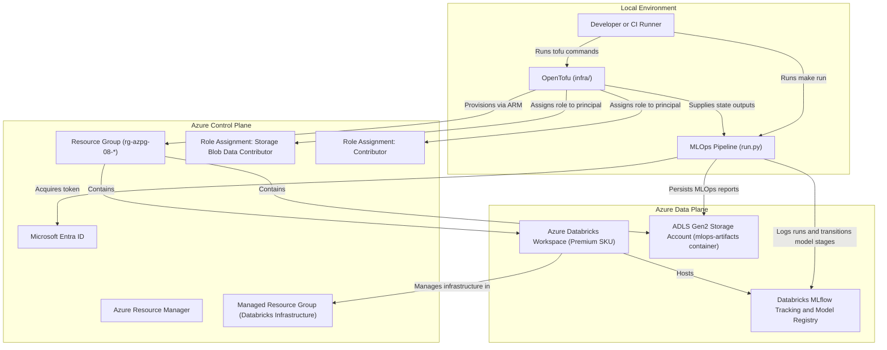

### 08: Databricks MLOps and Model Registry

Train candidate classification models on system telemetry metrics, track experiment runs and hyperparameters in Databricks MLflow, register and promote the winning champion model to Production stage in Databricks Model Registry, run holdout inference, and persist governance reports to Azure Data Lake Storage Gen2.

#### Architecture



#### MLOps Lifecycle Flow

The Python runner executes a complete, self-contained candidate training, experiment tracking, model registry promotion, verification, and cleanup cycle:

```mermaid
flowchart LR
    subgraph Step1["1. Candidate Training"]
        TrainModels["Train Logistic Models with Varying Hyperparameters"]
    end

    subgraph Step2["2. Experiment Tracking"]
        LogMLflow["Log Parameters and Evaluation Metrics to MLflow"]
    end

    subgraph Step3["3. Model Registry"]
        PromoteChampion["Register Winning Model and Promote to Production"]
    end

    subgraph Step4["4. Inference"]
        HoldoutScoring["Score Holdout Outage Risk Telemetry"]
    end

    subgraph Step5["5. Persistence"]
        WriteLakehouse["Persist JSON MLOps Reports to ADLS Gen2"]
    end

    subgraph Step6["6. Teardown"]
        CleanArtifacts["Clean Up Experiment, Model, and Storage Blobs"]
    end

    TrainModels --> LogMLflow
    LogMLflow --> PromoteChampion
    PromoteChampion --> HoldoutScoring
    HoldoutScoring --> WriteLakehouse
    WriteLakehouse --> CleanArtifacts
```



#### Prerequisites

- Python 3.14 or newer, uv, GNU Make, Azure CLI, and OpenTofu 1.8 or newer.
- A non-production Azure subscription with access to Azure Databricks.
- An allowed deployment region supporting Azure Databricks and ADLS Gen2 (such as `swedencentral` or `westeurope`).
- Role assignment permissions on the resource group to assign `Storage Blob Data Contributor` and `Contributor`.
- The `Microsoft.Databricks` and `Microsoft.Storage` resource providers registered on your subscription.

From the repository root, install dependencies and sign in:

```bash
make install
make login
```

#### Configure the Sandbox

Navigate to the project directory and prepare configuration:

```bash
cd projects/08-mlops-databricks
cp infra/terraform.tfvars.example infra/terraform.tfvars
az account list --query '[].{name:name,id:id}' --output table
az ad signed-in-user show --query id --output tsv
```

Update each field in `infra/terraform.tfvars`:

- `subscription_id`: The target Azure subscription identifier.
- `location`: An Azure region where both Azure Databricks and ADLS Gen2 storage are supported, such as `swedencentral`.
- `resource_group_name`: A dedicated name starting with `rg-azpg-08-`.
- `storage_account_name`: A globally unique name starting with `azpg08`, containing only lowercase alphanumeric characters.
- `databricks_workspace_name`: A name for the Databricks workspace, such as `azpg08-sandbox-dbx`.
- `principal_object_id`: The object identifier of your signed-in identity.

Verify resource provider registrations:

```bash
az provider show --subscription YOUR_SUBSCRIPTION_ID \
  --namespace Microsoft.Databricks --query registrationState --output tsv
az provider show --subscription YOUR_SUBSCRIPTION_ID \
  --namespace Microsoft.Storage --query registrationState --output tsv
```

All commands must return `Registered`.

#### Run and Clean Up

```bash
make plan
make up
make run
make down
```

- `make plan` displays an execution plan for the ADLS Gen2 storage account, container, Azure Databricks workspace, and role assignments.
- `make up` requires entering `yes` before provisioning infrastructure.
- `make run` prompts for confirmation, runs candidate training, logs runs to Databricks MLflow, registers the champion model, transitions stage to Production, scores holdout telemetry, writes MLOps reports to lakehouse storage, verifies them, and cleans up temporary artifacts.
- `make down` requires entering `yes` and destroys all sandbox resources created for this project.

The runner generates a unique run identifier for each execution.
Candidate training errors, MLflow communication issues, or metric threshold violations stop the run.
Cleanup covers all test Databricks experiments, registered models, and storage report blobs.
Failed deletions produce a failed exit and identify remaining artifacts. Always run `make down` when finished.

#### Common Issues and Troubleshooting

- Missing provider registration: If OpenTofu returns `MissingSubscriptionRegistration`, run `az provider register --namespace Microsoft.Databricks` and wait until the status changes to `Registered`.
- Workspace provisioning duration: Azure Databricks workspaces take between two and four minutes to provision. Allow `make up` to complete before executing `make run`.
- First-time workspace activation: When a new Azure Databricks workspace is created, Databricks requires a one-time Single Sign-On initialization. Open the workspace URL or click Launch Workspace in the Azure Portal once in your browser before executing `make run`.
- Role propagation delay: Azure RBAC role assignments can take several minutes to propagate. If `run.py` fails with authorization errors immediately after `make up`, wait three to five minutes and retry `make run`.
- Quality threshold failure: If champion model F1 score falls below 0.70, the pipeline exits with an error to highlight model regressions.

ROC-AUC uses probability rankings and gives tied scores half credit.
Evaluation needs both binary classes.
If training, logging, or registration fails, the runner attempts to remove the experiments and registered models already created by that run.
